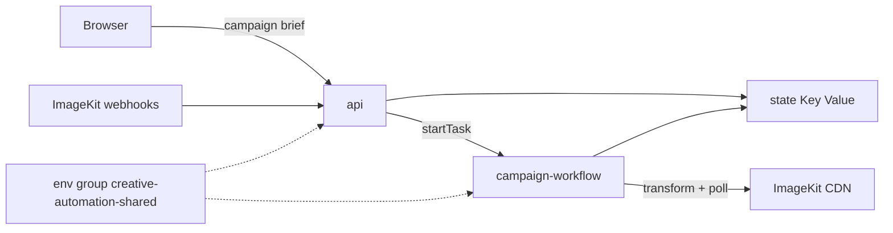

# Why deploy ImageKit creative automation on Render?

ImageKit transformations are not always synchronous. An AI edit or video re-encode can take longer than a single HTTP request should block for - ImageKit may return a **200** with `is-intermediate-response: true` before the render is actually done. Running a campaign of many asset × variant pairs needs per-item retries, partial-failure handling, and a real concurrency cap - things a single `for` loop or Cloud Function handles poorly.

This template deploys an Express API and demo UI, with a Render Workflows service that fans each (asset × variant) pair into its own tracked, retryable task. You add ImageKit credentials; Render handles the web service, Key Value, and workflow runtime. Submit one campaign brief and get a CSV manifest of finished CDN URLs (or clear errors) without babysitting a long-running script.

[](https://render.com/deploy?repo=https://github.com/gitpichardo/creative-automation-workflow)

## Architecture



## What you can build

A running campaign runner: pick a DAM folder, list output variants (crops, AI edits, video formats), watch progress live, and download a CSV of finished ImageKit URLs. Each render is an independent Workflows task with its own retries - one failure does not cancel the rest.

## Key features

- **Workflows fan-out**: One `renderVariant` task per asset × variant, settled with `Promise.allSettled` so partial failure still yields a manifest.
- **Async protocol handled**: Polls ImageKit until ready (`is-intermediate-response`, video `302`, `ik-error`), with optional webhook shortcut for video.
- **Concurrency hard-capped at 5**: Matches the n8n batch template - not env-tunable, so a large brief cannot flood ImageKit.
- **Safety size caps**: Default 200 assets per campaign, at most 20 variants per brief.
- **One-click deploy**: The Blueprint creates the Key Value instance, Workflow service, and `api`, and wires `REDIS_URL` and `WORKFLOW_SLUG` between them. You enter the ImageKit keys once.
- **Demo UI**: Submit a brief, watch `queued` → `rendering` → `ready`/`error`/`timeout`, download the grid and CSV.
- **Bundled sample assets**: Three test images and ready-made variants files in [`samples/`](samples), so the first run needs no setup in ImageKit.

## Use cases

- Marketing team renders square, story, and thumb crops across a campaign folder
- Creative ops runs AI background swaps / upscales as independent jobs with retries
- Video pipeline generates multiple output formats and waits via webhook when configured
- Agency reuses one deployable template for client localization batches

## What's included

| Resource | Type | Purpose |
|---|---|---|
| `creative-automation-state` | Key Value | Campaign progress, webhook correlation, idempotency |
| `creative-automation-workflow` | Workflow | `runCampaign` / `renderVariant` fan-out |
| `creative-automation-api` | Web Service | Demo UI, campaign API, ImageKit webhook receiver, sample upload |
| `creative-automation-shared` | Environment group | Safety caps shared by the api and workflow |

The Blueprint creates all of them under a `creative-automation` project (`production` environment).

## Prerequisites

- **ImageKit Private Key**: From [API keys](https://imagekit.io/dashboard/developer/api-keys) (starts with `private_`).
- **ImageKit Public Key**: Same dashboard page.
- **ImageKit URL Endpoint**: From [URL endpoints](https://imagekit.io/dashboard/url-endpoints) (e.g. `https://ik.imagekit.io/<id>`).
- **Render API Key**: To let `api` start workflow runs - [create one](https://render.com/docs/api#1-create-an-api-key).
- **ImageKit Webhook Secret** (optional): For video `transformation.ready` / `error` shortcuts - [webhooks](https://imagekit.io/dashboard/developer/webhooks).

Free ImageKit accounts work for basic transforms. AI transforms consume extension units.

## Next steps

1. **Deploy the Blueprint** - Click Deploy to Render above. When prompted, enter:

   | Key | Service | Value |
   |---|---|---|
   | `IMAGEKIT_PRIVATE_KEY` | workflow | your private key |
   | `IMAGEKIT_PUBLIC_KEY` | workflow | your public key |
   | `IMAGEKIT_URL_ENDPOINT` | workflow | `https://ik.imagekit.io/<your_id>` |
   | `IMAGEKIT_WEBHOOK_SECRET` | workflow | optional; leave empty to skip the video webhook shortcut |
   | `RENDER_API_KEY` | api | a [Render API key](https://render.com/docs/api#1-create-an-api-key), so the api can start workflow runs |

   The api copies the ImageKit values from the workflow, and `REDIS_URL` and `WORKFLOW_SLUG` are filled in for you. If you set a webhook secret, register `<api-url>/webhooks/imagekit` in ImageKit.
2. **Run a campaign** - See [Try it](#try-it) below.

## Try it

Everything the first run needs is in [`samples/`](samples):

| File | What it is |
|---|---|
| `samples/images/*.jpg` | 3 product photos (1024×1024) |
| `samples/variants.json` | Basic resizes: square, story, thumbnail |
| `samples/variants-ai.json` | AI background removal + upscale |
| `samples/brief.json` | A full campaign brief for the command line |

1. Open the `api` service URL and click **Upload sample images**. This copies `samples/images` into `/campaigns/demo` in your ImageKit media library (files already there are skipped).
2. The rest of the form is prefilled: source folder `/campaigns/demo`, and variants loaded from `samples/variants.json`. Click **Start campaign**.
3. You should see 9 rows (3 images × 3 variants) move from `queued` through `rendering` to `ready`, a grid of finished renders, and a **Download manifest.csv** link.
4. Optional AI run (consumes extension units): click **AI background + upscale** to load `samples/variants-ai.json`. These two slower variants exercise the `is-intermediate-response` polling path.
5. Optional failure check: change one variant's transformation to something invalid. That row ends as `error` with an ImageKit message while the others still finish.

Same thing from the command line, from a clone of this repo:

```sh
curl -X POST https://<your-api>.onrender.com/samples/upload
curl -X POST https://<your-api>.onrender.com/campaigns \
  -H "Content-Type: application/json" \
  --data @samples/brief.json
# 202 { "id": "...", "statusUrl": "..." }  then:  curl https://<your-api>.onrender.com/campaigns/<id>
```

### Local development

```sh
npm install
cp .env.example .env   # fill ImageKit keys + REDIS_URL (e.g. redis://localhost:6379)
npm test
npm run dev:api        # http://localhost:3000 - needs RENDER_API_KEY + WORKFLOW_SLUG to start real runs
```

### Auto-deploy note

Services created with a plain repo URL (API/CLI) do not auto-deploy on push. This repo’s [`.github/workflows/deploy.yml`](.github/workflows/deploy.yml) runs tests then redeploys both services via the Render CLI when `RENDER_API_KEY` is set as a GitHub secret.

## Resources

- [Render Workflows](https://render.com/docs/workflows)
- [Render environment groups](https://render.com/docs/configure-environment-variables#environment-groups)
- [ImageKit transformations](https://imagekit.io/docs/transformations)
- [ImageKit AI transformations](https://imagekit.io/docs/ai-transformations)
- [ImageKit video transformation (cache / first request)](https://imagekit.io/docs/video-transformation#first-time-request-and-cache)
- [Render Key Value](https://render.com/docs/key-value)
- [Deploy to Render](https://render.com/docs/deploy-to-render)

## License

MIT
