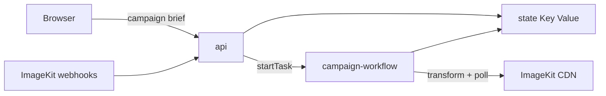

# Why deploy ImageKit creative automation on Render?

ImageKit transformations are not always synchronous. An AI edit or video re-encode can take longer than a single HTTP request should block for — ImageKit may return a **200** with `is-intermediate-response: true` before the render is actually done. Running a campaign of many asset × variant pairs needs per-item retries, partial-failure handling, and a real concurrency cap — things a single `for` loop or Cloud Function handles poorly.

This template deploys an Express API and demo UI pre-wired to Render Key Value, with a Render Workflows service that fans each (asset × variant) pair into its own tracked, retryable task. You add ImageKit credentials; Render handles the web service, Key Value, and workflow runtime. Submit one campaign brief and get a CSV manifest of finished CDN URLs (or clear errors) without babysitting a long-running script.

[](https://render.com/deploy?repo=https://github.com/gitpichardo/creative-automation-workflow)

> The button deploys **api** + **state** from [`render.yaml`](render.yaml). Create **campaign-workflow** separately in the Dashboard — [Blueprints do not yet manage Workflow services](https://render.com/docs/workflows). Steps below.

## Architecture



## What you can build

A running campaign runner: pick a DAM folder, list output variants (crops, AI edits, video formats), watch progress live, and download a CSV of finished ImageKit URLs. Each render is an independent Workflows task with its own retries — one failure does not cancel the rest.

## Key features

- **Workflows fan-out**: One `renderVariant` task per asset × variant, settled with `Promise.allSettled` so partial failure still yields a manifest.
- **Async protocol handled**: Polls ImageKit until ready (`is-intermediate-response`, video `302`, `ik-error`), with optional webhook shortcut for video.
- **Concurrency hard-capped at 5**: Matches the n8n batch template — not env-tunable, so a large brief cannot flood ImageKit.
- **Safety size caps**: Default 200 assets per campaign, at most 20 variants per brief.
- **Demo UI**: Submit a brief, watch `queued` → `rendering` → `ready`/`error`/`timeout`, download the grid and CSV.
- **Deploy to Render**: Blueprint for api + Key Value; workflow created once in the Dashboard.

## Use cases

- Marketing team renders square, story, and thumb crops across a campaign folder
- Creative ops runs AI background swaps / upscales as independent jobs with retries
- Video pipeline generates multiple output formats and waits via webhook when configured
- Agency reuses one deployable template for client localization batches

## What's included

| Service | Type | Purpose |
|---|---|---|
| `creative-automation-api` | Web Service | Demo UI, campaign API, ImageKit webhook receiver |
| `creative-automation-workflow` | Workflow | `runCampaign` / `renderVariant` fan-out (Dashboard) |
| `creative-automation-state` | Key Value | Campaign progress, webhook correlation, idempotency |

## Prerequisites

- **ImageKit Private Key**: From [API keys](https://imagekit.io/dashboard/developer/api-keys) (starts with `private_`).
- **ImageKit Public Key**: Same dashboard page.
- **ImageKit URL Endpoint**: From [URL endpoints](https://imagekit.io/dashboard/url-endpoints) (e.g. `https://ik.imagekit.io/<id>`).
- **Render API Key** (after workflow exists): To let `api` start workflow runs — [create one](https://render.com/docs/api#1-create-an-api-key).
- **ImageKit Webhook Secret** (optional): For video `transformation.ready` / `error` shortcuts — [webhooks](https://imagekit.io/dashboard/developer/webhooks).

Free ImageKit accounts work for basic transforms. AI transforms consume extension units.

## Next steps

1. **Deploy the Blueprint** — Click Deploy to Render above. Fill in `IMAGEKIT_PRIVATE_KEY`, `IMAGEKIT_PUBLIC_KEY`, and `IMAGEKIT_URL_ENDPOINT`. Leave `RENDER_API_KEY` and `WORKFLOW_SLUG` blank for now. `REDIS_URL` is wired automatically.
2. **Create the Workflow service** — Dashboard → **New → Workflow**. Same repo. Language: Node. Build: `npm ci && npm run build`. Start: `npm run start:workflow`. Set the same ImageKit vars plus `REDIS_URL` (copy from `api` / the Key Value internal connection string). Note the workflow **slug**.
3. **Connect api to the workflow** — On `api`, set `RENDER_API_KEY` and `WORKFLOW_SLUG`, then redeploy. Optionally register `<api-url>/webhooks/imagekit` in ImageKit and set `IMAGEKIT_WEBHOOK_SECRET`.
4. **Run a campaign** — Open the `api` URL. Submit a brief with a folder that has assets and a few variants. Progress should move through statuses; when complete, download the CSV manifest.
5. **Confirm a failure path** — Use an invalid transformation once and check that the manifest row shows `error` with an `ik-error` message while other variants still finish.

### Local development

```sh
npm install
cp .env.example .env   # fill ImageKit keys + REDIS_URL (e.g. redis://localhost:6379)
npm test
npm run dev:api        # http://localhost:3000 — needs RENDER_API_KEY + WORKFLOW_SLUG to start real runs
```

### Auto-deploy note

Services created with a plain repo URL (API/CLI) do not auto-deploy on push. This repo’s [`.github/workflows/deploy.yml`](.github/workflows/deploy.yml) runs tests then redeploys both services via the Render CLI when `RENDER_API_KEY` is set as a GitHub secret.

## Resources

- [Render Workflows](https://render.com/docs/workflows)
- [ImageKit transformations](https://imagekit.io/docs/transformations)
- [ImageKit AI transformations](https://imagekit.io/docs/ai-transformations)
- [ImageKit video transformation (cache / first request)](https://imagekit.io/docs/video-transformation#first-time-request-and-cache)
- [Render Key Value](https://render.com/docs/key-value)
- [Deploy to Render](https://render.com/docs/deploy-to-render)

## License

MIT
