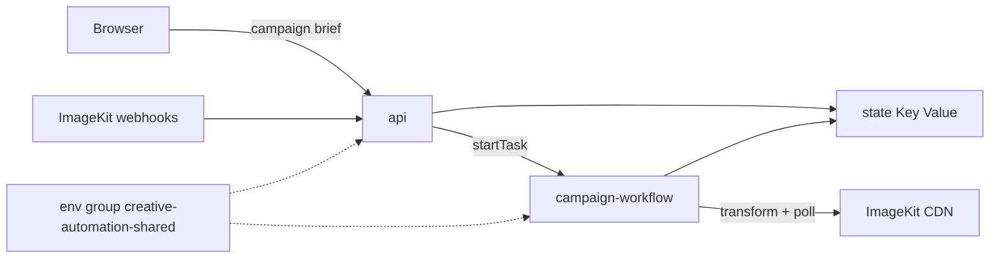

# Why deploy ImageKit creative automation on Render?

ImageKit transformations are not always synchronous. An AI edit or video re-encode can take longer than a single HTTP request should block for - ImageKit may return a **200** with `is-intermediate-response: true` before the render is actually done. Running a campaign of many asset × variant pairs needs per-item retries, partial-failure handling, and a real concurrency cap - things a single `for` loop or Cloud Function handles poorly.

This template deploys an Express API and demo UI, with a Render Workflows service that fans each (asset × variant) pair into its own tracked, retryable task. You add ImageKit credentials; Render handles the web service, Key Value, and workflow runtime. Submit one campaign brief and get a CSV manifest of finished CDN URLs (or clear errors) without babysitting a long-running script.

> [Blueprints do not yet manage Workflow services](https://render.com/docs/workflows), so you create the env group, Key Value instance, and Workflow service first, then deploy the Blueprint (which creates the `api`). Follow [Next steps](#next-steps) in order, then use the button.

[](https://render.com/deploy?repo=https://github.com/gitpichardo/creative-automation-workflow)

## Architecture



## What you can build

A running campaign runner: pick a DAM folder, list output variants (crops, AI edits, video formats), watch progress live, and download a CSV of finished ImageKit URLs. Each render is an independent Workflows task with its own retries - one failure does not cancel the rest.

## Key features

- **Workflows fan-out**: One `renderVariant` task per asset × variant, settled with `Promise.allSettled` so partial failure still yields a manifest.
- **Async protocol handled**: Polls ImageKit until ready (`is-intermediate-response`, video `302`, `ik-error`), with optional webhook shortcut for video.
- **Concurrency hard-capped at 5**: Matches the n8n batch template - not env-tunable, so a large brief cannot flood ImageKit.
- **Safety size caps**: Default 200 assets per campaign, at most 20 variants per brief.
- **Shared env group**: ImageKit keys and `REDIS_URL` live in one group linked to both services.
- **Demo UI**: Submit a brief, watch `queued` → `rendering` → `ready`/`error`/`timeout`, download the grid and CSV.

## Use cases

- Marketing team renders square, story, and thumb crops across a campaign folder
- Creative ops runs AI background swaps / upscales as independent jobs with retries
- Video pipeline generates multiple output formats and waits via webhook when configured
- Agency reuses one deployable template for client localization batches

## What's included

| Resource | Type | Created by | Purpose |
|---|---|---|---|
| `creative-automation-shared` | Environment group | You (Dashboard) | ImageKit keys, `REDIS_URL`, safety caps; linked to api and workflow |
| `creative-automation-trigger` | Environment group | Blueprint | `RENDER_API_KEY` for the api |
| `creative-automation-state` | Key Value | You (Dashboard) | Campaign progress, webhook correlation, idempotency |
| `creative-automation-workflow` | Workflow | You (Dashboard) | `runCampaign` / `renderVariant` fan-out |
| `creative-automation-api` | Web Service | Blueprint | Demo UI, campaign API, ImageKit webhook receiver |

The Blueprint nests the `api` under a `creative-automation` project (`production` environment).

## Prerequisites

- **ImageKit Private Key**: From [API keys](https://imagekit.io/dashboard/developer/api-keys) (starts with `private_`).
- **ImageKit Public Key**: Same dashboard page.
- **ImageKit URL Endpoint**: From [URL endpoints](https://imagekit.io/dashboard/url-endpoints) (e.g. `https://ik.imagekit.io/<id>`).
- **Render API Key**: To let `api` start workflow runs - [create one](https://render.com/docs/api#1-create-an-api-key).
- **ImageKit Webhook Secret** (optional): For video `transformation.ready` / `error` shortcuts - [webhooks](https://imagekit.io/dashboard/developer/webhooks).

Free ImageKit accounts work for basic transforms. AI transforms consume extension units.

## Next steps

Do these in order. The workflow needs the group and Key Value before it exists, and the Blueprint needs the workflow slug.

1. **Create the Key Value instance** - Dashboard → **New → Key Value**, name it `creative-automation-state`, same region as your other services. Copy its **internal** connection string.
2. **Create the env group** - Dashboard → **Environment Groups → New**, name it exactly `creative-automation-shared`, with:

   | Key | Value |
   |---|---|
   | `IMAGEKIT_PRIVATE_KEY` | your private key |
   | `IMAGEKIT_PUBLIC_KEY` | your public key |
   | `IMAGEKIT_URL_ENDPOINT` | `https://ik.imagekit.io/<your_id>` |
   | `REDIS_URL` | internal connection string from step 1 |
   | `MAX_ASSETS_PER_CAMPAIGN` | `200` |
   | `AWAIT_TRANSFORMATION_TIMEOUT_MS` | `120000` |

3. **Create the Workflow service** - Dashboard → **New → Workflow**. Same repo. Language: Node. Build: `npm ci && npm run build`. Start: `npm run start:workflow`. Under **Environment**, link `creative-automation-shared`. Note the workflow **slug**.
4. **Deploy the Blueprint** - Click Deploy to Render above. When prompted, enter `WORKFLOW_SLUG` (from step 3) and `RENDER_API_KEY`. Optionally set `IMAGEKIT_WEBHOOK_SECRET`; register `<api-url>/webhooks/imagekit` in ImageKit for the video shortcut.
5. **Add test assets and run a campaign** - See [Try it](#try-it) below.

## Try it

Prepare a few source assets, then submit a brief from the demo UI.

1. In the [ImageKit media library](https://imagekit.io/dashboard/media-library), create a folder `/campaigns/demo` and upload 2 or 3 JPG/PNG images (any size).
2. Open the `api` service URL. The form is prefilled; confirm these values:

   | Field | Value |
   |---|---|
   | Campaign name | `Demo campaign` |
   | Source folder | `/campaigns/demo` |
   | Asset filter | leave empty (or `tags IN ["approved"]` after tagging one image `approved`) |
   | Variants | the **Basic resizes** preset |

3. Variants JSON (same as the Basic resizes preset):

   ```json
   [
     { "name": "square-1080", "transformation": [{ "width": 1080, "height": 1080, "focus": "auto" }] },
     { "name": "story-1080x1920", "transformation": [{ "width": 1080, "height": 1920, "focus": "auto" }] },
     { "name": "thumb-320", "transformation": [{ "width": 320, "height": 320, "focus": "auto", "quality": 80 }] }
   ]
   ```

4. Click **Start campaign**. With 3 images you should see 9 rows (3 assets × 3 variants) move from `queued` through `rendering` to `ready`, a grid of finished renders, and a **Download manifest.csv** link.
5. Optional AI run (consumes extension units): click **AI background + upscale** for two slower variants that exercise the `is-intermediate-response` polling path.
6. Optional failure check: change one variant's transformation to something invalid. That row ends as `error` with an ImageKit message while the others still finish.

Same thing from the command line:

```sh
curl -X POST https://<your-api>.onrender.com/campaigns \
  -H "Content-Type: application/json" \
  -d '{
        "name": "Demo campaign",
        "folder": "/campaigns/demo",
        "variants": [
          { "name": "square-1080", "transformation": [{ "width": 1080, "height": 1080, "focus": "auto" }] },
          { "name": "thumb-320", "transformation": [{ "width": 320, "height": 320, "quality": 80 }] }
        ]
      }'
# 202 { "id": "...", "statusUrl": "..." }  then:  curl https://<your-api>.onrender.com/campaigns/<id>
```

### Local development

```sh
npm install
cp .env.example .env   # fill ImageKit keys + REDIS_URL (e.g. redis://localhost:6379)
npm test
npm run dev:api        # http://localhost:3000 - needs RENDER_API_KEY + WORKFLOW_SLUG to start real runs
```

### Auto-deploy note

Services created with a plain repo URL (API/CLI) do not auto-deploy on push. This repo’s [`.github/workflows/deploy.yml`](.github/workflows/deploy.yml) runs tests then redeploys both services via the Render CLI when `RENDER_API_KEY` is set as a GitHub secret.

## Resources

- [Render Workflows](https://render.com/docs/workflows)
- [Render environment groups](https://render.com/docs/configure-environment-variables#environment-groups)
- [ImageKit transformations](https://imagekit.io/docs/transformations)
- [ImageKit AI transformations](https://imagekit.io/docs/ai-transformations)
- [ImageKit video transformation (cache / first request)](https://imagekit.io/docs/video-transformation#first-time-request-and-cache)
- [Render Key Value](https://render.com/docs/key-value)
- [Deploy to Render](https://render.com/docs/deploy-to-render)

## License

MIT
